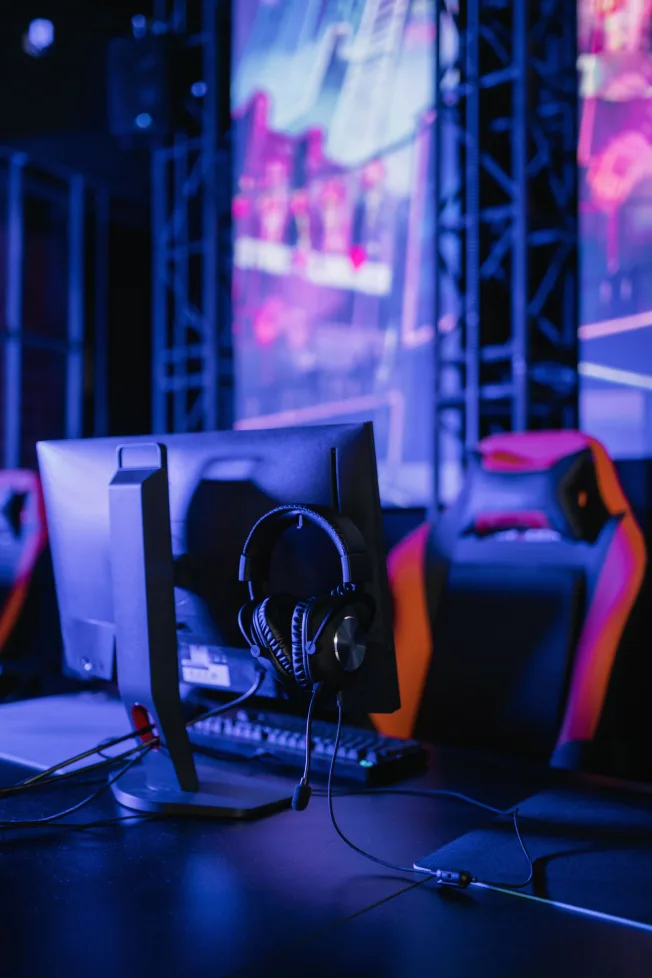

Se você já tentou jogar um multiplayer competitivo no Linux, provavelmente esbarrou em uma mensagem de erro ou em um banimento inesperado. Hoje, o principal motivo para um jogo **não** funcionar no Linux já não é técnico: é o **sistema anti-cheat**.

## Por que o anti-cheat é um problema?

Muitos sistemas anti-trapaça funcionam no **nível do kernel** do Windows, ou seja, com acesso profundo ao sistema operacional para detectar programas suspeitos. Esse tipo de abordagem não tem equivalente direto no Linux, e o Proton não consegue simplesmente "traduzir" esse comportamento.

## A boa notícia: o suporte já existe

Dois dos sistemas mais usados do mercado, o **Easy Anti-Cheat** e o **BattlEye**, já oferecem suporte oficial ao Proton. A ativação, porém, depende de cada desenvolvedora, que precisa:

1. Habilitar o suporte ao Linux no painel do anti-cheat;
2. Testar o jogo no Proton;
3. Publicar a atualização.

Vários títulos populares já fizeram isso e rodam normalmente no Linux e no Steam Deck.

## Por que alguns jogos continuam bloqueados?

Algumas empresas optam por não liberar o acesso por motivos como:

- **Medo de facilitar trapaças**, já que o Linux é um sistema aberto e mais difícil de monitorar;
- **Base de jogadores pequena**, que não justificaria o custo de testes e suporte;
- **Anti-cheats próprios em nível de kernel**, que simplesmente não funcionam fora do Windows.

## Como saber se o seu jogo funciona

O site **Are We Anti-Cheat Yet?** mantém uma lista atualizada de jogos com anti-cheat, indicando quais estão **suportados**, **funcionando**, **quebrados** ou **negados** pelas desenvolvedoras. Vale consultar antes de comprar qualquer jogo competitivo.

## O que esperar daqui para frente

O crescimento do Steam Deck colocou milhões de jogadores rodando Linux sem nem perceber. Quanto maior essa base, mais difícil fica para as empresas ignorá-la. A tendência é que o número de jogos liberados continue crescendo, mas a decisão final segue nas mãos de cada estúdio.
