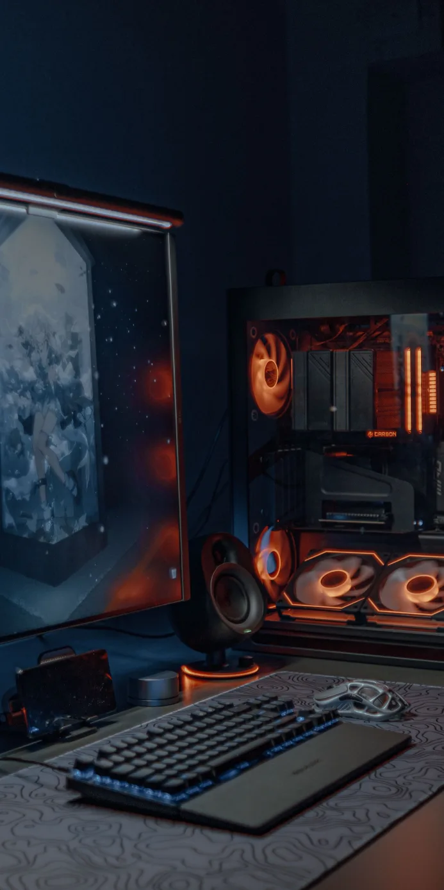

Começar a jogar no Linux está mais fácil do que nunca, mas alguns ajustes fazem toda a diferença no desempenho e na estabilidade. Neste guia, reunimos o essencial para deixar sua distro pronta para a jogatina.

## 1. Escolha uma distro atualizada

Distribuições com pacotes recentes costumam trazer drivers e kernels mais novos, o que melhora a compatibilidade com hardware e jogos. Algumas opções populares entre gamers:

- **Fedora**: atualizada e estável, com ótimo suporte a hardware recente;
- **Pop!_OS** e **Linux Mint**: amigáveis para iniciantes;
- **CachyOS**, **Nobara** e **Bazzite**: já vêm otimizadas para jogos.

## 2. Instale os drivers de vídeo corretos

- **AMD e Intel**: os drivers **Mesa** já vêm com a maioria das distros. Basta manter o sistema atualizado;
- **NVIDIA**: instale o driver oficial da NVIDIA pelo gerenciador de drivers ou repositório da sua distro.

Drivers desatualizados são a causa mais comum de travamentos e baixo desempenho.



## 3. Instale as lojas e launchers

- **Steam**: com o Proton, roda a maior parte do catálogo para Windows;
- **Heroic Games Launcher**: acesso aos jogos da Epic Games, GOG e Amazon;
- **Lutris**: centraliza jogos de várias fontes, inclusive emuladores;
- **Bottles**: cria ambientes isolados para rodar programas de Windows.

## 4. Ferramentas que melhoram a experiência

- **GameMode**: ajusta o sistema automaticamente para priorizar o jogo em execução;
- **MangoHud**: exibe FPS, uso de CPU, GPU e temperaturas na tela;
- **Gamescope**: o mesmo compositor usado no Steam Deck, útil para controlar resolução e limite de FPS;
- **ProtonUp-Qt**: instala versões alternativas do Proton, como o **Proton-GE**, que às vezes resolvem problemas específicos.

Na Steam, você pode ativar o GameMode e o MangoHud por jogo, nas **opções de inicialização**:

```
gamemoderun mangohud %command%
```

## 5. Consulte a comunidade

Antes de quebrar a cabeça com um jogo específico, pesquise no **ProtonDB**. Lá os próprios jogadores compartilham configurações, opções de inicialização e versões do Proton que funcionam melhor para cada título.

Com esses passos, seu Linux estará pronto para encarar desde indies leves até os lançamentos mais pesados. Bom jogo, pinguim!
